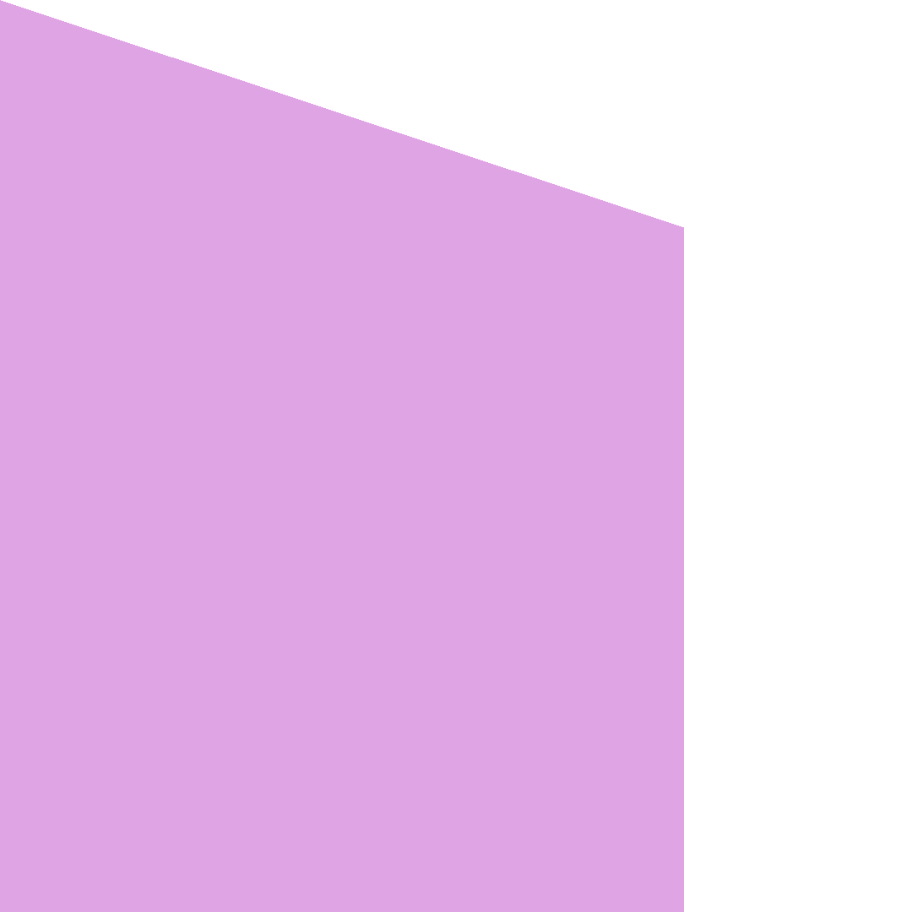
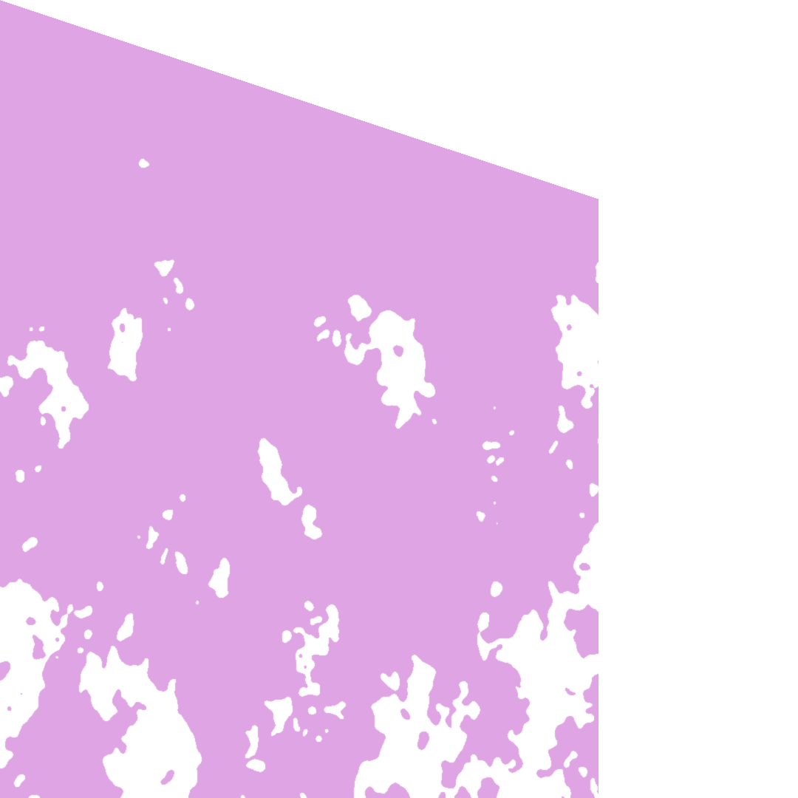
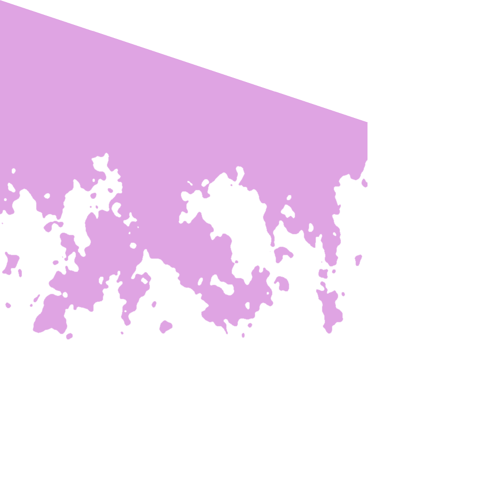
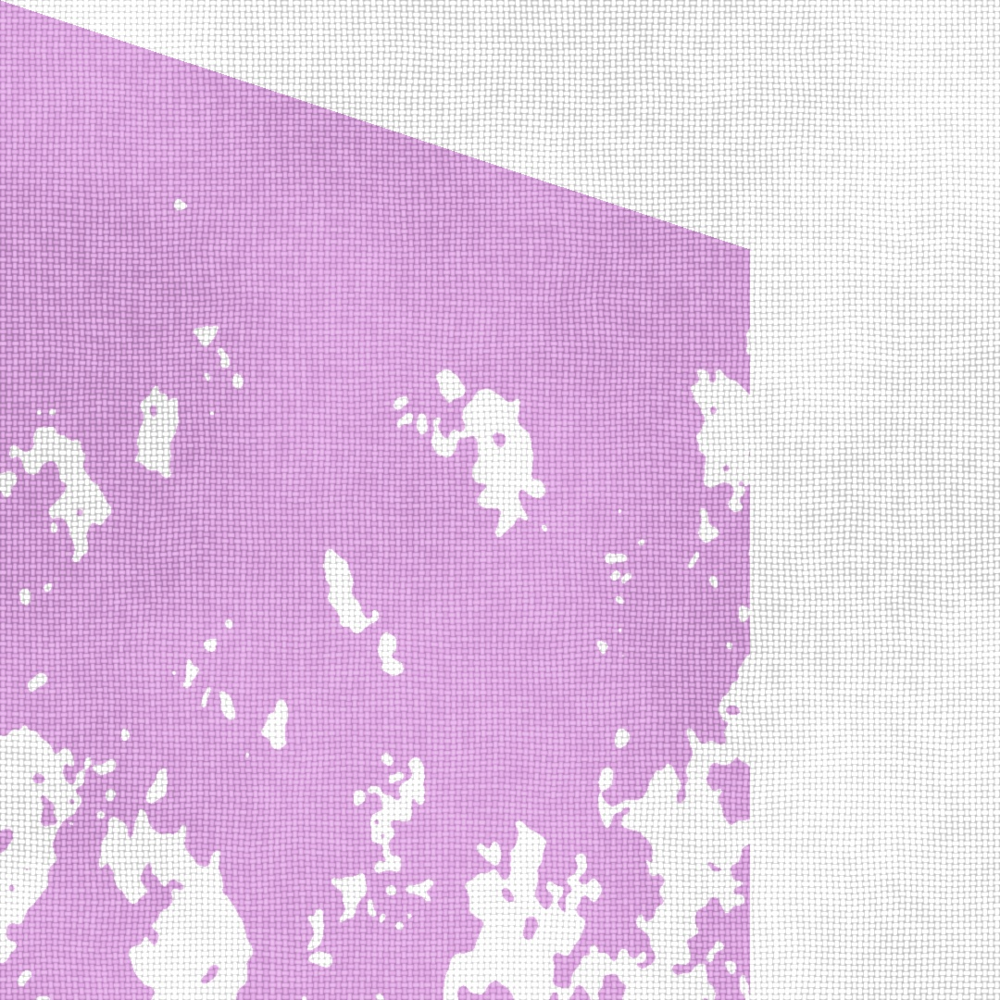

# nltl-image-gen

Generate square images of the nltl shapes (`face` and `space`, and their
variants `face2`/`space2`, `face3`/`space3`) in the nltl colours (the art
palette: `primary`, `secondary`, `bg-dark`, `bg-light`, `canvas`). Optional
effects make them look physically printed. Shapes and colours come from
[nltl-values](https://github.com/nothinglefttolearn/nltl-values), pinned in
`pyproject.toml`; colours are named without nltl-values' `art.` group
([why](docs/adr/0001-short-colour-names-in-recipes.md)).

```bash
mise install    # python + uv, pinned in mise.toml
uv sync         # pillow + nltl-values, pinned in uv.lock

uv run nltl-image                                   # flat face, primary, 2160px
uv run nltl-image --shape space --color secondary
uv run nltl-image --shape face3 --background canvas # palette colour as background
uv run nltl-image --padding 200                     # 200px margin on all sides
uv run nltl-image --background '#FFFFFF' --size 1080
```

Images are transparent PNGs written to `output/` as
`nltl-<shape>-<color>[-<preset>]-<timestamp>-s<seed>.png`. Set
`NLTL_IMAGE_OUTPUT_DIR` to write them somewhere else (relative paths are from
the current directory, `~` is expanded), or pass `--output` to choose an exact
path, which wins over both; a `.jpg` path needs `--background`. The default size, 2160px,
is the height of a 4K video frame and halves exactly to 1080p.
`python -m nltl_image` works too, and inside the mise-activated venv plain
`nltl-image` does.

## Batches

`--shape`, `--color` and the effect options (`--ink`, `--pull`, `--weave`,
`--depth`) take several values, and `--count` (`-n`) renders each
combination of them that many times, each time with a different seed, so
the print's pattern varies:

```bash
uv run nltl-image --print screenprint --ink 0.6 -n 10       # 10 different pulls
uv run nltl-image --shape face space3 --print screenprint --ink 0.4 0.7 0.9 -n 5
                                                            # 2 × 3 × 5 = 30 images
```

Every combination uses the same `--count` seeds, so images with the same
seed differ only in the settings you varied: the same pull at different
inks. With `--seed N` the seeds are N, N+1, …; without it they're random.
An effect option given several values goes in the file name too
(`nltl-face-primary-ink0.4-…-s123.png`). A batch can't use `--output`.

## Effects

There are two kinds of effect, and you can use either, both or neither:

- A **print** decides *where ink lands* inside the shape. It can leave gaps
  but never inks outside the outline. Choose one with `--print`.
- A **surface** makes the whole image look like it is on a material, ink
  and background alike. It changes colour only, never where ink is or how
  transparent anything is, so a transparent PNG keeps a clean edge. Choose
  one with `--surface`.

Effect settings are fractions of the image edge, so a render looks the same
at any size, just with more or fewer pixels.

| `flat` | `poster` | `worn` | `canvas-print` |
|---|---|---|---|
|  |  |  |  |

These are the four built-in [presets](#presets) at 1080px on a white
background, seed 7. Regenerate them with `mise run examples`.

### Screenprint (print)

An ink-starved screen print. Ink is pushed through a mesh by a squeegee and
runs out along the pull, leaving liquid-shaped gaps: rounded edges,
droplets, pinholes.

```bash
uv run nltl-image --print screenprint                       # ink 0.7, pulled top to bottom
uv run nltl-image --print screenprint --ink 0.9             # a good, nearly full pull
uv run nltl-image --print screenprint --ink 0.4 --pull 0    # sparse, pulled left to right
```

| Option | Default | Meaning |
|---|---|---|
| `--ink` | `0.7` | Roughly the fraction of the shape that gets ink, 0–1. |
| `--pull` | `270` | Squeegee direction in degrees counter-clockwise from rightward (270 = top to bottom). Patches streak along it and ink runs out towards its end. |

### Canvas (surface)

Artist's cotton canvas: a plain over-under weave of slightly irregular
threads, with faint uneven patches. Colour is lightened on the raised
threads and darkened between them. On a transparent background the weave
shows only on the ink; add `--background` to see the whole canvas.

```bash
uv run nltl-image --surface canvas --background '#FFFFFF'
uv run nltl-image --surface canvas --depth 0.6              # stronger weave
uv run nltl-image --surface canvas --weave 0.01             # coarser, ~100 threads across
uv run nltl-image --print screenprint --surface canvas --background '#FFFFFF'
```

| Option | Default | Meaning |
|---|---|---|
| `--weave` | `0.006` | Thread spacing as a fraction of the image edge (about 170 threads across). |
| `--depth` | `0.3` | How strongly the weave shades colour, 0–1. |

The defaults are tuned for video: threads are about 13px at 2160 and 6px at
1080, coarse enough to survive compression without shimmering. Much finer
weaves turn to mush or moiré once the image is encoded or zoomed.

Options only adjust an effect that is active: `--ink` without
`--print screenprint` (or a preset that has it) is an error.

## Presets

A preset is a named, reusable starting point: effects and their settings,
and optionally shape, colour, size, padding or background, but never a seed.
Explicit options override it.

```bash
uv run nltl-image --preset worn
uv run nltl-image --preset canvas-print --ink 0.7       # change one setting
uv run nltl-image --preset canvas-print --surface none  # drop the canvas
uv run nltl-image --preset my-look.toml                 # your own file
```

| Preset | Look |
|---|---|
| `flat` | Perfect flat colour: no print, no surface. Same as no preset. |
| `poster` | A good screenprint pull: nearly full, slight wear towards the end. |
| `worn` | The end of the run: the screen is drying out and gaps take over. Extends `poster`. |
| `canvas-print` | A `poster` pull on canvas. Extends `poster`. |

A preset file is TOML. `extends` takes a built-in name or a path relative
to the file, and settings in the extending file win:

```toml
description = "Canvas print, heavier weave, faded"
extends = "canvas-print"

[print.screenprint]
ink = 0.6

[surface.canvas]
depth = 0.45
```

Library-only settings work here too: screenprint's `starve`, `scale` and
`tension`, and canvas's `irregularity` and `mottle` (see the docstrings in
`prints.py` and `surfaces.py`). `nltl-image --help` lists the built-ins.

## Seeds and recipes

Every render has a seed that fixes all its random choices. Without `--seed`
one is picked at random and shown in the filename and the output
(`saved … (seed 48213)`).

Every image also carries its **recipe**: shape, colour, size, padding,
background, each effect with all its settings, and the seed. It's stored as
JSON in the PNG metadata (or the JPEG comment), so an image you like can be
reproduced exactly, even after you've forgotten how you made it:

```bash
uv run python -c "from nltl_image import read_recipe; print(read_recipe('output/nltl-face-primary-….png'))"
```

## Library

The same building blocks are importable:

```python
import random
from nltl_image import Canvas, Recipe, Screenprint, fill, render, save, shape_mask

recipe = Recipe("face", "primary", 2160, prints=[Screenprint(ink=0.6)], seed=7)
save(render(recipe), recipe, "face.png")  # recipe embedded

# Or compose by hand:
mask = Screenprint().apply(shape_mask("space", 2160), random.Random(1))
Canvas().apply(fill(mask, "#000000", background="#FFFFFF"), random.Random(2))
```

`Recipe` accepts any number of prints and surfaces, applied in order; the
CLI chooses at most one of each.

## Development

```bash
mise run test        # pytest (extra args pass through: mise run test -k padding)
mise run lint        # ruff check
mise run format      # ruff format
mise run check       # format check + lint + test, changes nothing
mise run examples    # re-render docs/images/
```
